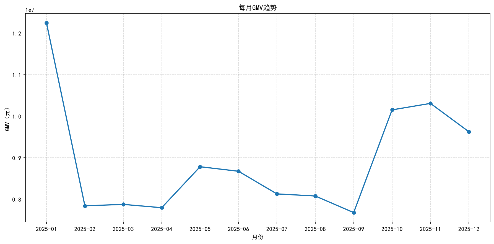

# 电商用户行为分析

基于 69,555 条电商用户行为日志（浏览 / 收藏 / 购买），分析平台的 GMV 结构和月度波动。



## 数据

69,555 条记录，时间范围 2024-12-31 至 2025-12-31。字段包括用户、商品、品牌、品类、行为类型、时间戳和售价。

数据文件已包含在仓库中（`UserBehavior_2025.csv`，6.9 MB），clone 下来直接能跑。字段说明见 `data/README.md`。

## 分析思路

1. 检查数据质量：缺失值 0、重复行 0，因此清洗工作主要在处理时间字段
2. 将 Unix 时间戳转为北京时间，提取日期和月份
3. 筛选 `buy` 行为，计算成交笔数、GMV、客单价
4. 按品类聚合，比较各品类的 GMV 贡献与订单量
5. 按月汇总，观察全年波动

## 结论

共 48,370 笔成交，GMV 1.07 亿元，客单价 2,215 元。

### 一、营收集中在高价低频品类

| 品类 | GMV 占比 | 订单占比 |
|---|---:|---:|
| 电子产品 | 61.0% | 22.3% |
| 家用电器 | 17.0% | 10.9% |
| 美妆护肤 | 10.0% | 18.8% |
| 家居用品 | 8.0% | 11.0% |
| 服装鞋帽 | 5.0% | 29.7% |
| 食品饮料 | 0.2% | 7.3% |

电子产品以 22.3% 的订单量贡献了 61.0% 的 GMV；服装鞋帽恰好相反，订单量最多（29.7%），GMV 仅占 5.0%。

如果只看订单量，会误判服装鞋帽是主力品类。实际营收依赖少数高价品类。这两类商品适合的运营目标不同：低价高频品类用于拉新和提升活跃度，高价低频品类承担利润。

### 二、GMV 波动主要由大促驱动

- 11 月 11 日单日 GMV 196 万元，平日 25–30 万元，为平日的 6.5 倍
- 1 月 22 日后，日均 GMV 由 20 余万元升至 70 余万元并持续至月底，与春节前备货节奏吻合
- 9 月为全年最低，768 万元

其余月份 GMV 均在 780–880 万元之间，波动很小。全年起伏基本由节日大促贡献。

对运营的直接含义：大促当日订单量为平日数倍，备货与客服需提前准备；9 月等淡季获客成本较低，适合拉新和测试新品。

## 运行方式

```
pip install -r requirements.txt
python analysis.py
```

图表输出至 `output/`。

## 已知问题

- 数据仅包含购买行为、无退款记录，1.07 亿元为成交额而非净收入
- 以一条记录计一笔订单；若单次购买包含多件商品，实际订单数少于 48,370
